<p align="center">
  
</p>

<h1 align="center">UNIVAG Athenas</h1>

<p align="center">
  <strong>Plataforma Integrada de Apoio Acadêmico, Monitorias, Maestrias e Aprendizagem Colaborativa</strong>
</p>

<p align="center">
  
  
  
  
  
</p>

---

## 📖 Sobre o Projeto

O **UNIVAG Athenas** é uma plataforma acadêmica desenvolvida para conectar estudantes e monitores universitários em um ambiente colaborativo, organizado e engajador. O sistema oferece agendamento inteligente com validação real de disponibilidade, chat em tempo real, busca global instantânea (`Ctrl+K`), emissão de certificados autenticados em PDF, controle de horas complementares e um ecossistema de gamificação com **Maestria por Disciplina (Nível 1 a 10)** e **Conjuntos de Perfil Completo**.

---

## ✨ Funcionalidades Principais

* **🧑‍🎓 Portal do Aluno & 👨‍🏫 Portal do Monitor (AVA UNIVAG Design)**:
  * Interfaces widescreen (`1560px`) com identidades visuais dedicadas: tema claro *Soft Slate/Ice* para o Aluno e tema escuro *AVA Dark Mode* para o Monitor.
  * Autenticação e cadastro com transição animada 3D entre perfis de Aluno e Monitor.
* **🔍 Barra de Pesquisa Inteligente em Tempo Real (`Ctrl+K`)**:
  * Busca global instantânea de alunos, monitores/orientadores, disciplinas e sessões com abas de filtro.
  * Ações rápidas exclusivas para monitores diretamente nos resultados (iniciar chat ou agendar sessão com o aluno em 1 clique).
* **📅 Gestão de Agenda e Disponibilidade Real**:
  * Calendário mensal e semanal interativo com filtros por status (*Todos*, *Próximas*, *Pendentes*, *Concluídas*).
  * Consulta automática da grade semanal do monitor e bloqueios de horário para exibir apenas horários realmente livres.
  * Cancelamento de sessões futuras, confirmação mútua de presença, avaliação de atendimento (1 a 5 estrelas) e registro de ata pelo monitor.
* **💬 Chat Integrado & Compartilhamento de Materiais**:
  * Conversas em tempo real entre alunos e monitores com envio de links de sala virtual (`HTTPS`) e anexos de estudo (`PDF`, `DOCX`, `XLSX`, `PPTX`, imagens e `TXT`) validados por *MIME type*.
* **🎮 Sistema de Pontos, Lojinha & Maestria de Matérias (Nv. 1 a 10)**:
  * **Múltiplas fontes de pontos acadêmicos**: presença proporcional à duração da aula (`+10 a +30 pts`), avaliação da monitoria (`+5 pts`), envio de material/dúvida (`+5 pts`), bônus de dedicação concedido pelo monitor (`+10 pts`) e bônus de perfil completo (`+15 pts`).
  * **12 Conjuntos de Perfil Completo**: desbloqueio unificado de *Banner Animado + Insígnia com Aura na Navbar* por preço único, com **Simulador/Provador ao vivo**.
  * **5 Relíquias Exclusivas de Maestria Nível 10**: conjuntos temáticos bem-humorados desbloqueados por mérito ao atingir o Nível 10 em *Banco de Dados*, *Lógica & Algoritmos*, *Estruturas de Dados*, *Web & Mobile Full-Stack* e *Redes*.
* **📜 Horas Complementares & Certificados Autenticados**:
  * Cálculo automático da carga horária validada (60h semestrais) e gerador de **Certificados de Monitoria** prontos para impressão/PDF com código de verificação `SHA-256`.

---

## 🛠️ Stack Tecnológica

* **Back-end:** PHP 8.3 (PDO com `ATTR_EMULATE_PREPARES = false`, `opcache`, `mod_rewrite`, `mod_headers`, `mod_deflate`)
* **Banco de Dados:** MySQL 8.4 / MariaDB InnoDB com suporte nativo a UTF-8 (`utf8mb4`)
* **Front-end:** HTML5 semântico, CSS3 responsivo widescreen (animações GPU-friendly e SVGs vetoriais embutidos) e JavaScript ES6+ Vanilla
* **Infraestrutura:** Docker & Docker Compose com rede isolada, *healthcheck* de banco e worker de lembretes

---

## 📂 Estrutura de Diretórios

```text
univag_athenas/
├── actions/                  # Endpoints e controladores (Chat, Monitorias, Busca Global, Auth, Notificações)
│   ├── buscaGlobal.php       # API JSON de busca instantânea (alunos, monitores, sessões e matérias)
│   ├── chat.php              # API de mensagens, conversas e horários disponíveis do monitor
│   ├── fotoPerfil.php        # Entrega segura de fotos de perfil com cache ETag (HTTP 304)
│   ├── logout.php            # Encerramento seguro de sessão e limpeza de cookies
│   ├── monitorias.php        # Presenças, avaliações, atas, materiais e crédito de pontos
│   ├── notificacoes.php      # Listagem e marcação de notificações em tempo real
│   ├── salvarCadastro*.php   # Controladores de registro de Aluno e Monitor
│   ├── salvarLoginUsuario.php# Autenticação com proteção contra brute-force e timing attacks
│   └── workerLembretes.php   # Daemon CLI para envio de lembretes de monitorias próximas
├── assets/
│   ├── css/                  # Folhas de estilo modulares (Aluno, Monitor, Loja, Personalização, Agenda)
│   ├── img/                  # Logotipos e ativos visuais
│   └── js/                   # Scripts de chat em tempo real e agendamento dinâmico do monitor
├── config/
│   └── conexao.php           # Conexão PDO centralizada com suporte a variáveis de ambiente
├── includes/
│   ├── auth.php              # Sessão segura, headers HTTP de defesa, RBAC e polyfills UTF-8
│   ├── gamificacao.php       # Catálogo unificado de conjuntos, ícones e cálculo de maestrias
│   ├── navbar.php            # Barra de navegação universal com busca viva, chat e notificações
│   └── processarCadastro.php # Validação centralizada de cadastro de usuários
├── sqlAthenas/
│   ├── schema.sql            # Schema completo e consolidado do banco de dados (UTF-8)
│   └── migrations/           # Histórico de migrações incrementais
├── views/
│   ├── agenda/               # Calendário interativo mensal/semanal de monitorias
│   ├── aluno/                # Painel do Aluno, Catálogo de Monitores, Matérias, Lojinha e Perfil
│   ├── auth/                 # Telas de Login e Cadastro com animação 3D Flip
│   ├── monitor/              # Painel do Monitor, Perfil/Disponibilidade, Horas e Certificados PDF
│   └── configuracoes.php     # Preferências de notificações e alteração segura de senha
├── docker-compose.yml        # Orquestração dos serviços (app, db e reminders)
├── Dockerfile                # Imagem PHP 8.3 Apache configurada para produção/desenvolvimento
└── php.ini                   # Configurações de segurança de sessão, timezone, upload e OPcache
```

---

## 🚀 Como Executar o Projeto (Modo Rápido para Apresentação)

O projeto conta com **inicialização automática do banco de dados**: você **não precisa configurar arquivo `.env`** nem importar o banco manualmente no `phpMyAdmin`. No primeiro acesso, o próprio sistema cria o banco `athenas`, todas as tabelas e as contas de demonstração automaticamente!

---

### 🪟 No Windows (Laboratórios / Máquina da UNIVAG)

1. **Baixe o projeto:**
   ```powershell
   git clone https://github.com/eduardoclemes1-tech/univag_athenas.git
   cd univag_athenas
   ```
2. **Inicie com 1 clique:**
   * Abra a pasta do projeto e dê **2 cliques no arquivo `INICIAR_WINDOWS.bat`**
   *(Ele detecta sozinho se a máquina tem **Docker Desktop** ou **XAMPP**, inicia o MySQL + PHP e já abre o navegador automaticamente em `http://localhost:8000`!).*

   **Ou, se preferir rodar pelo terminal:**
   * **Com Docker:** `docker compose up -d --build` → acesse `http://localhost:8000`
   * **Com XAMPP:** Ligue o **Apache** e o **MySQL** no painel do XAMPP, coloque a pasta em `C:\xampp\htdocs\univag_athenas` e acesse `http://localhost/univag_athenas` *(o banco será criado sozinho ao abrir a página!)*.

---

### 🐧 No Linux (Ubuntu / Debian / Mint)

1. **Baixe o projeto e entre na pasta:**
   ```bash
   git clone https://github.com/eduardoclemes1-tech/univag_athenas.git
   cd univag_athenas
   ```
2. **Inicie com 1 comando:**
   ```bash
   ./iniciar-linux.sh
   ```
   *(Ou diretamente com Docker: `docker compose up -d --build` | Ou com PHP local: `php -S localhost:8000`)*.
3. **Acesse no navegador:**
   👉 **[http://localhost:8000](http://localhost:8000)**

---

### Contas de Demonstração (Ambiente de Desenvolvimento)
* **Aluno:** `aluno@univag.br` | Senha: `123456`
* **Monitor:** `admin@univag.br` | Senha: `123456`

---

## 🔒 Práticas de Segurança da Informação Implementadas

* **Prevenção contra SQL Injection (SQLi):** Uso estrito de *Prepared Statements* no PDO com `PDO::ATTR_EMULATE_PREPARES => false`.
* **Proteção contra Cross-Site Request Forgery (CSRF):** Validação criptográfica em tempo constante (`hash_equals`) de tokens `csrf_token` em todas as rotas `POST` e chamadas `fetch`.
* **Prevenção contra Cross-Site Scripting (XSS):** Sanitização sistemática com `htmlspecialchars(..., ENT_QUOTES, 'UTF-8')` no PHP e construção de nós DOM via `textContent` no JavaScript.
* **Autenticação e Sessão Endurecidas:**
  * Senhas armazenadas com `password_hash(..., PASSWORD_DEFAULT)` (`bcrypt`).
  * Mitigação de *Timing Attacks* e *User Enumeration* no login com verificação constante de hash.
  * *Rate Limiting* de sessão no login (bloqueio temporário após 5 tentativas inválidas em 60 segundos).
  * Regeneração de ID de sessão (`session_regenerate_id(true)`) no login e na troca de senha, com cookies `HttpOnly`, `SameSite=Lax` e `session.use_strict_mode=1`.
* **Validação Estrita de Uploads e Path Traversal:** Verificação real de *MIME type* via `finfo`, nomes de armazenamento gerados com entropia criptográfica (`random_bytes(32)`), validação de `realpath` fora da árvore pública e header `X-Content-Type-Options: nosniff`.
* **Cabeçalhos HTTP de Segurança:** Emissão de `X-Frame-Options: SAMEORIGIN`, `X-Content-Type-Options: nosniff` e `Referrer-Policy: strict-origin-when-cross-origin`.

---

## 🤝 Como Contribuir

Consulte o arquivo [CONTRIBUTING.md](CONTRIBUTING.md) para diretrizes de desenvolvimento e envio de Pull Requests, e [SECURITY.md](SECURITY.md) para nossa política de reporte responsável de vulnerabilidades.

---

## 📄 Licença

Distribuído sob a licença **MIT**. Consulte o arquivo [LICENSE](LICENSE) para mais detalhes.
